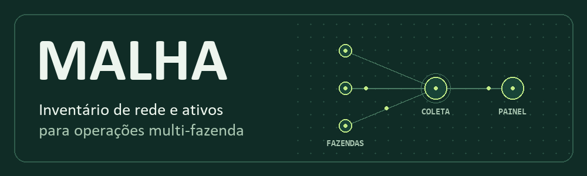

# Malha



[](https://github.com/targino-tech/malha/actions/workflows/ci.yml)


Visibilidade do inventário e da coleta de rede para grupos agrícolas com várias fazendas. O painel mostra a origem dos registros e diferencia falha de comunicação de um ativo observado offline.

## Rode o demo

Requisitos: Node.js **24.22.3** e pnpm **12.18.0**. O demo local usa PGlite com dados fictícios e persiste em `.malha/demo`. Use `MALHA_DEMO_DB=memory://` para uma sessão descartável.

```sh
npm install --global pnpm@12.18.0
pnpm install --frozen-lockfile
MALHA_MODE=demo pnpm dev
```

No PowerShell, use `$env:MALHA_MODE = 'demo'` antes de executar `pnpm dev`. Acesse [http://127.0.0.1:3000](http://127.0.0.1:3000).

A página de apresentação fica em [/site](http://127.0.0.1:3000/site). Usa Motion para as transições e hospeda a própria tipografia Barlow Condensed, com os termos OFL em `apps/web/public/malha/BARLOW-OFL.txt`.

1. Em **Importações**, selecione uma fazenda e envie o [CSV de exemplo](examples/inventario.csv).
2. Clique em **Validar arquivo**, confira a prévia e confirme a importação.
3. Em **Inventário**, filtre a fazenda, encontre `CAMPO-002` e abra os detalhes do ativo.
4. Em **Ocorrências**, confira o coletor sem contato da Fazenda Santa Luzia e o switch offline da Fazenda Vale Verde e reconheça uma delas.
5. Em **Administração**, cadastre uma fazenda e um membro. Em **Integrações**, gere o código de ativação do coletor da nova fazenda.
6. Em **Inventário**, use **Novo ativo** para cadastrar um equipamento manual com local técnico, responsável e janela de manutenção. Arquive e restaure pelo detalhe do ativo, que também mostra o histórico.
7. Em **Conciliação**, confira um item do cadastro e confirme ou vincule uma descoberta UniFi.
8. Em **Indicadores**, defina a linha de base. Em **Ocorrências**, registre um atendimento e volte aos indicadores para ver horas e economia estimadas.
9. Em **Auditoria**, confira as ações registradas. Inventário, evidências e auditoria exportam CSV com fórmulas neutralizadas.

O CSV aceita UTF-8, até 5 MiB e 10 mil linhas. Use as colunas `etiqueta`, `nome` e `categoria`. As colunas `criticidade`, `mac` e `ip` são opcionais. Baixe o modelo na tela de importação.

## Coletor UniFi

Instale Go **1.27.4** e rode os comandos em `collector/`. Configure o prefixo local de Integrações documentado pela console, por exemplo `https://console.example/proxy/network/integration/v1`. Use uma chave da integração e a cadeia TLS confiável. `UNIFI_CA_FILE` aponta para um certificado PEM quando a unidade tem CA privada.

```sh
cd collector
go build -o malha-collector .
export UNIFI_BASE_URL='https://console.example/proxy/network/integration/v1'
export UNIFI_API_KEY_FILE='/caminho/protegido/unifi-api-key'
./malha-collector sites
export UNIFI_SITE_ID='<UUID do site selecionado>'
export MALHA_DATA_DIR='/caminho/gravavel/malha'
export MALHA_URL='https://malha.example'
export MALHA_ENROLL_CODE_FILE='/caminho/protegido/codigo-uso-unico'
./malha-collector enroll
unset MALHA_ENROLL_CODE_FILE
./malha-collector run
```

O código de ativação associa o coletor a uma única fazenda. O coletor assina as mensagens com Ed25519, faz somente GET na console e retém lotes no SQLite durante quedas da WAN. O modo HTTP do Malha é exclusivo de endereços loopback para laboratório. [Documentação da API oficial UniFi](https://help.ui.com/hc/en-us/articles/30076656117655-Getting-Started-with-the-Official-UniFi-API)

Veja [a instalação do serviço Linux](collector/README.md). Para testar a integração local com uma controladora de laboratório, inicie o demo com `MALHA_DEMO_DB=memory://`, use `MALHA_URL=http://127.0.0.1:3000` e `MALHA_ENROLL_CODE=malha-demo-entrada-000000000000000000000000`. O código é fictício e está vinculado à Fazenda Horizonte. Use um novo diretório de dados do coletor para cada nova sessão descartável.

## Prepare o ambiente de piloto

Use PostgreSQL 17 com endpoint privado. O [`compose.yml`](compose.yml) fornece um banco local de laboratório com `MALHA_LOCAL_DB_PASSWORD` definida no shell. Configure `MALHA_MODE=pilot`, `DATABASE_URL` e as variáveis de identidade do [`.env.example`](.env.example). Cadastre a aplicação como **Web** no Entra ID, permita somente o diretório do cliente e registre `https://<host-do-app>/api/auth/callback`. Restrinja a atribuição de usuários e aplique MFA no diretório.

Use um papel administrativo separado para a preparação do banco. Após a migração, aplique [`packages/db/runtime-grants.sql`](packages/db/runtime-grants.sql) com o administrador e conceda `malha_runtime` ao login do serviço. O login deve operar sem `SUPERUSER` e sem `BYPASSRLS`. Os comandos de configuração retornam os identificadores necessários para o passo seguinte.

```sh
pnpm db migrate
pnpm db configure <tenant-id> <oid-do-administrador> 'Grupo piloto'
pnpm db farm <org-id> 'Fazenda piloto' 'Município · MT'
pnpm db enroll <org-id> <farm-id>
pnpm build
```

Depois do primeiro admin, o restante da preparação pode ser feito na interface: **Administração** cadastra fazendas e membros (pelo object ID do Entra ID) e **Integrações** gera e revoga códigos de ativação. Os papéis são admin do grupo, TI do grupo, técnico de fazenda (só nas fazendas atribuídas), diretoria (leitura) e auditor (leitura). TI, diretoria e auditor podem ser restritos a fazendas específicas. Aplique de novo [`packages/db/runtime-grants.sql`](packages/db/runtime-grants.sql) após migrar.

Execute `pnpm worker` junto com o serviço web. O worker aplica as capturas, avalia as regras de ocorrência a cada minuto e envia e-mail das ocorrências críticas. Configure `MALHA_SMTP_URL` e `MALHA_ALERT_FROM` (o endpoint SMTP do Amazon SES serve) e cadastre os destinatários com `pnpm db recipient <org-id> <email>`. Use `pnpm db recipient-remove <org-id> <email>` para desativar um destinatário. Para um proxy HTTPS no mesmo host, `pnpm start` escuta no loopback. O piloto depende de TLS no proxy e de `MALHA_PUBLIC_ORIGIN` igual à origem HTTPS acessada no navegador. Armazene o código de ativação como segredo e use `pnpm db revoke <org-id> <farm-id>` para revogar o coletor.

## Estrutura e verificações

```text
apps/web/      Dashboard Next.js e API HTTP
apps/worker/   Processamento assíncrono da outbox
packages/db/   Migrações e administração do PostgreSQL
collector/     Coletor Go e fila local
tests/         Testes Node e Playwright
```

```sh
pnpm lint
pnpm typecheck
pnpm test
pnpm build
pnpm exec playwright install chromium
pnpm test:e2e
cd collector
go test ./...
```

Veja [a arquitetura do primeiro corte](docs/arquitetura.md) e as variáveis em [`.env.example`](.env.example). A homologação com console física e um diretório Entra do cliente é pré-requisito para o piloto. O pipeline do GitHub Actions verifica o código e os fluxos do demo. A implantação AWS faz parte da próxima etapa.

## Segurança

Os resultados das verificações de código, dependências, segredos e malware ficam no [workflow de segurança](https://github.com/targino-tech/malha/actions/workflows/security.yml). Consulte a [política de segurança](SECURITY.md) para relatar uma vulnerabilidade por um canal privado.
