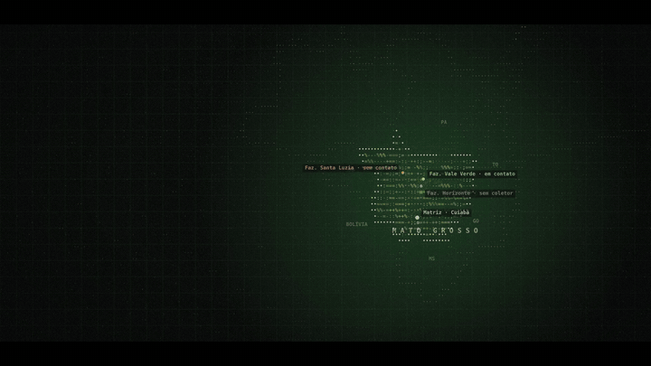
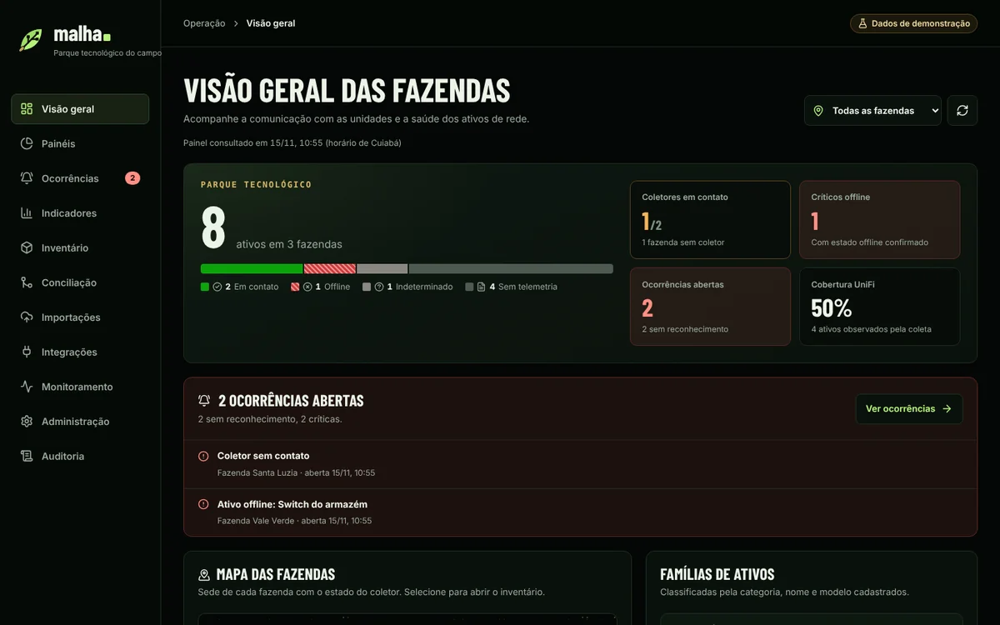
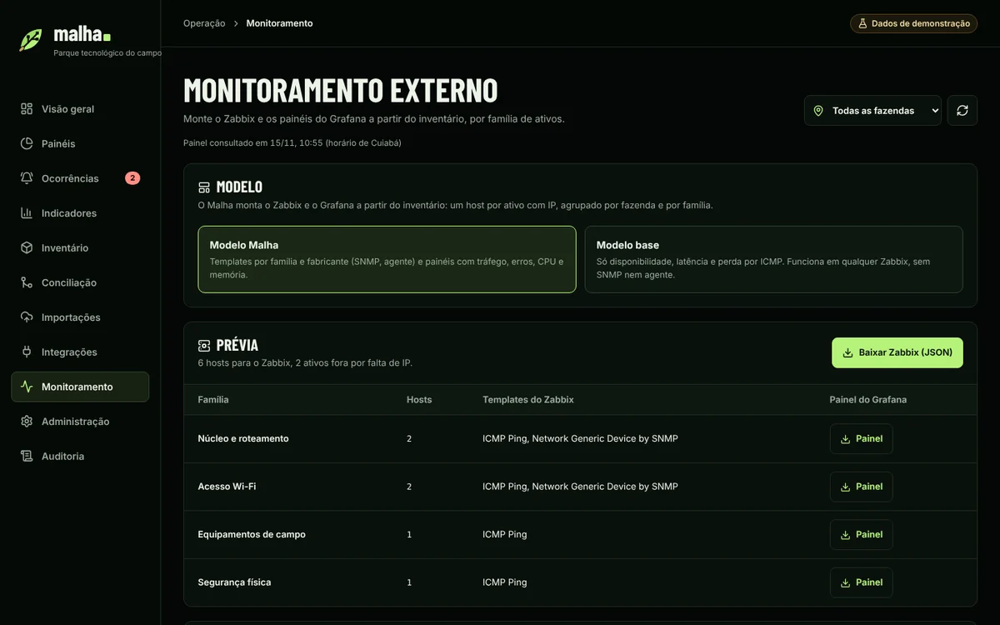
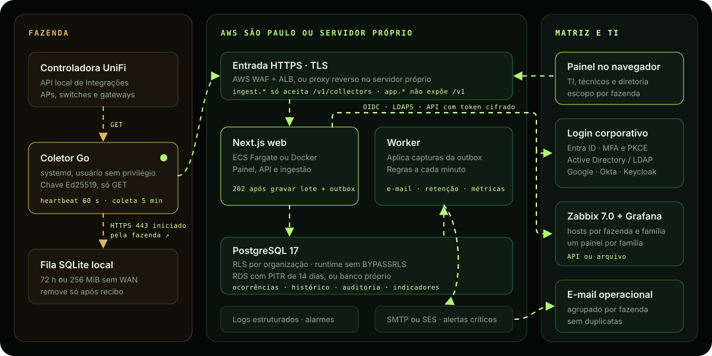

<p align="center">
  
</p>

<p align="center">
  <a href="https://targino-tech.github.io/malha/"><b>Site</b></a> ·
  <a href="https://targino-tech.github.io/malha/video/"><b>Vídeo</b></a> ·
  <a href="#rode-o-demo"><b>Demo</b></a> ·
  <a href="docs/instalacao.md"><b>Instalação</b></a> ·
  <a href="docs/integracoes.md"><b>Integrações</b></a> ·
  <a href="CONTRIBUTING.md"><b>Contribuir</b></a>
</p>

<p align="center">
  <a href="https://github.com/targino-tech/malha/actions/workflows/ci.yml"></a>
  <a href="https://github.com/targino-tech/malha/actions/workflows/security.yml"></a>
  <a href="https://github.com/targino-tech/malha/actions/workflows/codeql.yml"></a>
  <a href="https://scorecard.dev/viewer/?uri=github.com/targino-tech/malha"></a>
  <a href="LICENSE"></a>
</p>

<a href="https://targino-tech.github.io/malha/video/"></a>

<p align="center"><sub>▶ <a href="https://targino-tech.github.io/malha/video/">Assistir ao vídeo completo com som (45 s)</a> · <a href="docs/media/video/malha-45s.mp4">baixar MP4</a></sub></p>

## O que é

O Malha mostra à matriz de um grupo agrícola, em um só painel, **quais fazendas estão reportando, quais ativos críticos merecem atenção e onde o cadastro diverge da rede real**. Um coletor em cada fazenda lê a controladora UniFi (somente leitura) e envia lotes assinados; o inventário entra por CSV ou pela interface. É grátis e open source, sem recurso bloqueado.

- **Alerta em 3 minutos** quando uma fazenda perde contato, com e-mail para os ativos críticos.
- **Parque tecnológico** com mapa das fazendas, painéis e conciliação entre cadastro e coleta.
- **Zabbix e Grafana** montados a partir do inventário, por arquivo ou direto pela API.
- **Login corporativo** com Entra ID, Active Directory/LDAP ou Google, Okta e Keycloak.
- **Dados isolados** por grupo no banco e restrição por fazenda para cada papel.

## Telas

| Visão geral | Painéis |
| --- | --- |
|  |  |
| **Ocorrências** | **Monitoramento** |
|  |  |

<sub>Dados de demonstração.</sub>

<a id="rode-o-demo"></a>

## Rode o demo

Requer Node.js 24. O demo usa dados fictícios e não precisa de banco externo.

```sh
npm install --global pnpm@12.18.0
pnpm install --frozen-lockfile
MALHA_MODE=demo pnpm dev
```

Abra [127.0.0.1:3000](http://127.0.0.1:3000) para o painel e [/site](http://127.0.0.1:3000/site) para o site. Com Docker: `docker build --target web -t malha-web .` e `docker run --rm -p 3000:3000 -e MALHA_MODE=demo -e MALHA_DEMO_DB=memory:// malha-web`.

Coletor, PostgreSQL, login corporativo e deploy estão no **[guia de instalação](docs/instalacao.md)**.

## Como funciona

<p align="center">
  
</p>

| Peça | Papel |
| --- | --- |
| [`collector/`](collector) | Coletor Go na fazenda: lê o UniFi só com GET, assina com Ed25519 e guarda 72 h de fila |
| [`apps/web/`](apps/web) | Painel, API, ingestão, login, Zabbix/Grafana, site e portal (Next.js 16) |
| [`apps/worker/`](apps/worker) | Capturas, regras de ocorrência a cada minuto, e-mail e retenção |
| [`packages/db/`](packages/db) | Migrações do PostgreSQL 17 com RLS por organização e CLI de administração |
| [`infra/`](infra) | Terraform opcional para AWS São Paulo |

Detalhes e garantias de segurança em [`docs/arquitetura.md`](docs/arquitetura.md).

## Integrações

**UniFi** · **CSV** · **Zabbix 7.0** · **Grafana** · **Entra ID** · **AD/LDAP** · **Google, Okta e Keycloak (OIDC)** · **SMTP/SES**. Como configurar cada uma está no [guia de integrações](docs/integracoes.md).

## Contribua

Toda ajuda conta: código, documentação, testes com o seu equipamento ou um modelo de monitoramento para um fabricante novo.

- [Como contribuir](CONTRIBUTING.md) e os critérios de pull request
- [Boas primeiras issues](https://github.com/targino-tech/malha/labels/boa%20primeira%20issue) e o [roadmap](ROADMAP.md)
- [Discussões](https://github.com/targino-tech/malha/discussions) para dúvidas e ideias
- [Código de conduta](CODE_OF_CONDUCT.md) e [governança](GOVERNANCE.md)

<a href="https://github.com/targino-tech/malha/graphs/contributors"></a>

## Segurança

Vulnerabilidades vão pelo **[relato privado do GitHub](https://github.com/targino-tech/malha/security/advisories/new)**, nunca por issue pública; veja a [política de segurança](SECURITY.md). Cada mudança passa por CodeQL, Semgrep, Gitleaks, ClamAV, auditoria de dependências e OpenSSF Scorecard.

> **Nunca exponha o modo demo na internet.** Ele entra como administrador sem login. Em qualquer instalação acessível por outras pessoas, use `MALHA_MODE=pilot`.

## Licença

Software livre sob a [GNU AGPL v3.0 ou posterior](LICENSE). Quem oferecer uma versão modificada como serviço pela rede deve disponibilizar o código-fonte dessa versão aos usuários dela.
