<p align="center">
  
</p>

<p align="center">
  <a href="https://github.com/targino-tech/malha/actions/workflows/ci.yml"></a>
  <a href="https://github.com/targino-tech/malha/actions/workflows/security.yml"></a>
  
  
  
  
  
</p>


O Malha mostra à matriz de um grupo agrícola, em um só painel, **quais fazendas estão reportando, quais ativos críticos merecem investigação e onde o cadastro diverge da rede real**. Um coletor instalado em cada fazenda lê a controladora UniFi local (somente leitura) e envia lotes assinados para a nuvem. O cadastro patrimonial entra por CSV ou pela interface.

| Problema no campo | O que o Malha entrega |
| --- | --- |
| A TI só descobre a queda quando alguém liga da fazenda | Ocorrência aberta em até 3 min sem heartbeat, com e-mail para os críticos |
| A planilha de ativos não bate com o que está na rede | Conciliação entre cadastro e coleta, com fila de descobertas e divergências |
| Viagens para diagnosticar o que podia ser visto de longe | Histórico por ativo, atendimentos registrados e horas economizadas medidas |
| A diretoria não enxerga o valor da TI | Indicadores de cobertura, inventário conferido, tempo de detecção e economia |
| Medo de dar acesso à rede para um fornecedor | Coletor só faz GET, conexão sempre iniciada pela fazenda e mensagens assinadas |


<p align="center">
  
</p>

| Peça | Onde | Responsabilidade |
| --- | --- | --- |
| `collector/` | Linux na fazenda, Go 1.27, systemd | Lê a API local de Integrações do UniFi, assina com Ed25519, fila SQLite de 72 h |
| `apps/web/` | ECS Fargate, Next.js 16 | Painel, BFF, ingestão `/v1/collectors`, site público e portal |
| `apps/worker/` | ECS Fargate | Outbox de capturas, regras a cada minuto, e-mail, retenção e métricas |
| `packages/db/` | RDS PostgreSQL 17 | Migrações SQL, RLS por organização, CLI de administração |
| `infra/` | Terraform | VPC, RDS, ECS, ALB + WAF, SES, ECR, alarmes, orçamento e OIDC do GitHub |

**Garantias de segurança:** o escopo do coletor vem da chave cadastrada; cada requisição leva prova JWS com nonce de uso único e hash do corpo; lotes repetidos devolvem o recibo original e conteúdo divergente recebe 409; o runtime do banco opera sem `BYPASSRLS`; login por Entra ID com PKCE e sessão revalidada a cada requisição; fazendas fora do escopo respondem como inexistentes. Detalhes em [`docs/arquitetura.md`](docs/arquitetura.md) e [`infra/README.md`](infra/README.md).


| Área | Funcionalidades |
| --- | --- |
| **Coleta** | Ativação com código de uso único, heartbeat 60 s, coleta 5 min, capturas em partes, idempotência, recuperação após queda da WAN, desvio de relógio do coletor |
| **Ocorrências** | Coletor sem contato, coleta desatualizada, ativo offline confirmado, divergência após 3 capturas; supressão durante perda de contato; reconhecimento auditado |
| **Alertas** | E-mail só para críticos, agrupado por fazenda, sem duplicatas, suspenso em manutenção |
| **Inventário** | CSV com prévia e erros por linha, cadastro manual, local técnico, responsável, janela de manutenção, arquivamento, busca e paginação no servidor |
| **Conciliação** | Descobertas UniFi, vínculos automáticos por MAC para confirmar ou desfazer, cadastro de referência para conferir, histórico transferido na fusão |
| **Valor** | Atendimentos, linha de base aprovada pelo cliente, cobertura, inventário conferido, detecção (mediana e P90), reconhecimento, horas e economia, tendência semanal |
| **Acesso** | Admin, TI, técnico de fazenda, diretoria e auditor, com restrição por fazenda; administração de fazendas, membros e coletores pela interface |
| **Evidências** | Trilha de auditoria, exportação CSV de inventário, ocorrências e auditoria com fórmulas neutralizadas |
| **Site e portal** | Landing com globo ASCII, planos, cadastro de interessados com limite e honeypot, portal de entrada do cliente |
| **Produção** | Imagens Docker, Terraform AWS, deploy por OIDC com migração dedicada e smoke test, release assinada do coletor com retorno automático |


<p align="center"></p>

O símbolo é uma malha de cinco nós ligados em forma de **M**, a rede de fazendas conversando com a matriz. O site usa fundo tinta com verde-limão e trigo da colheita; o painel usa base clara com verde-mata para leitura prolongada. A tipografia combina **Barlow Condensed** nos títulos, **Inter** no texto e monoespaçada só em identificadores técnicos.

| Site público | Planos |
| --- | --- |
| 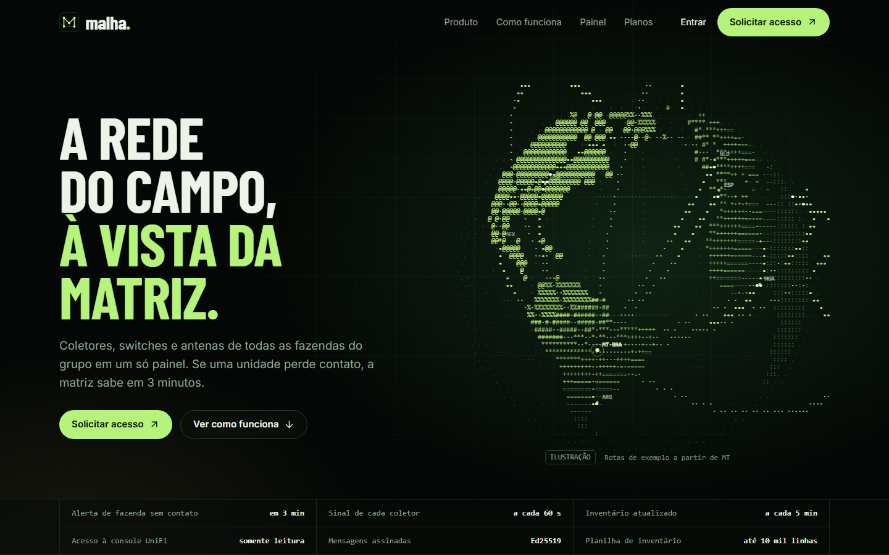 | 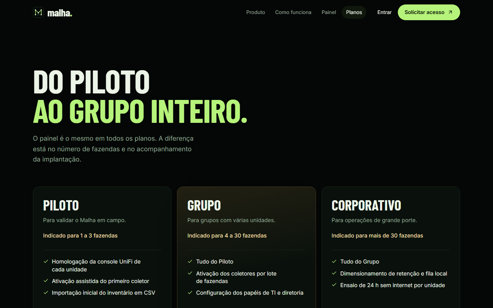 |
| **Visão geral** | **Ocorrências** |
| 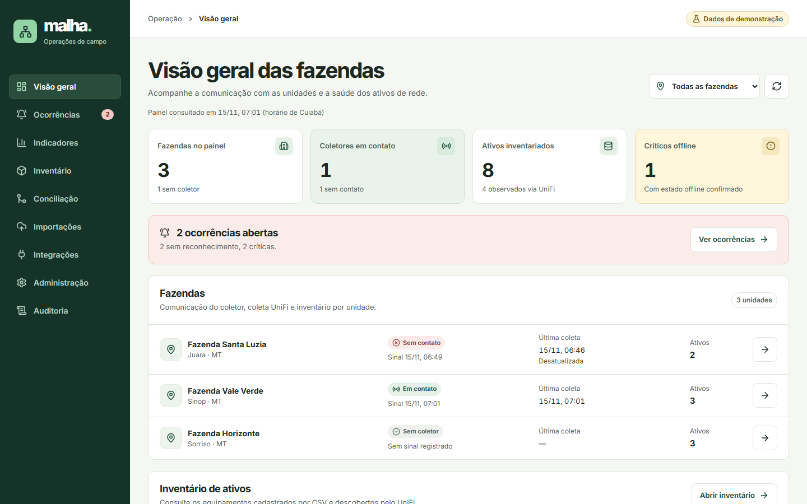 | 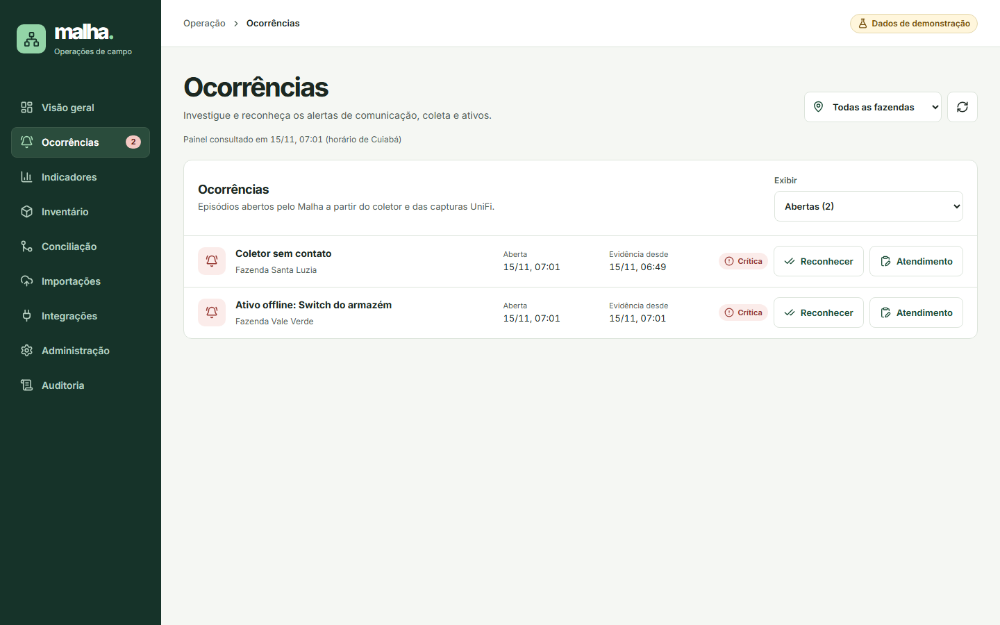 |
| **Indicadores** | **Conciliação** |
| 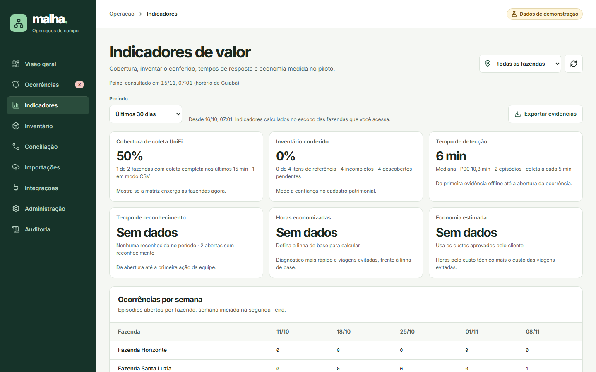 | 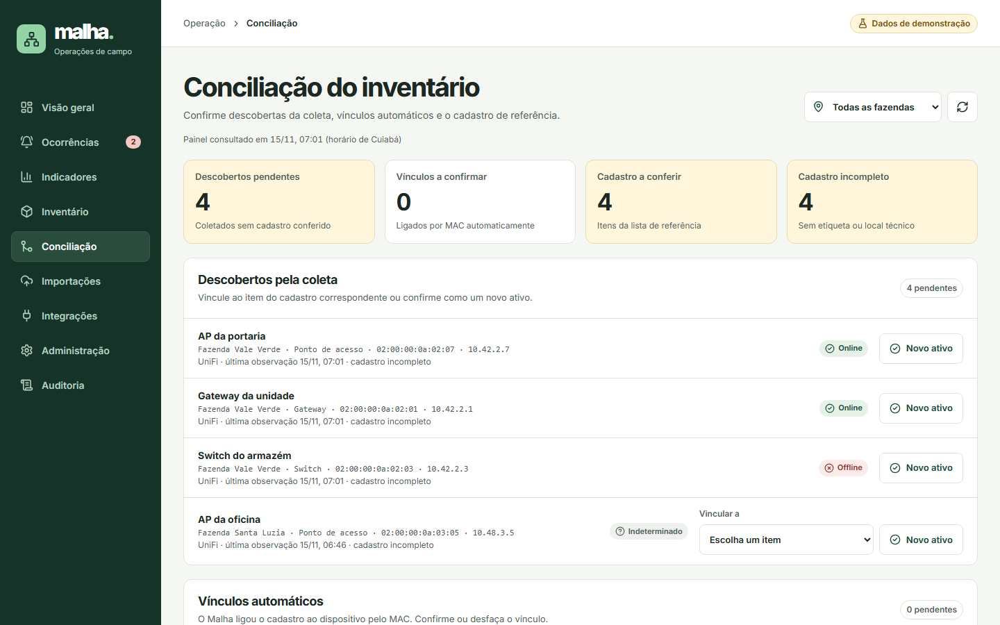 |
| **Integrações** | **Detalhe do ativo** |
| 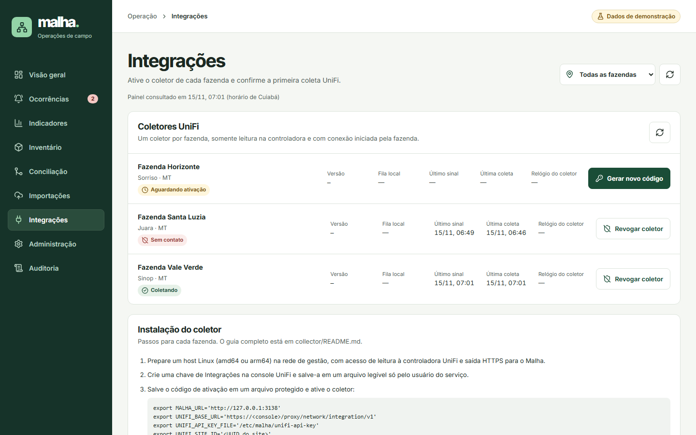 | 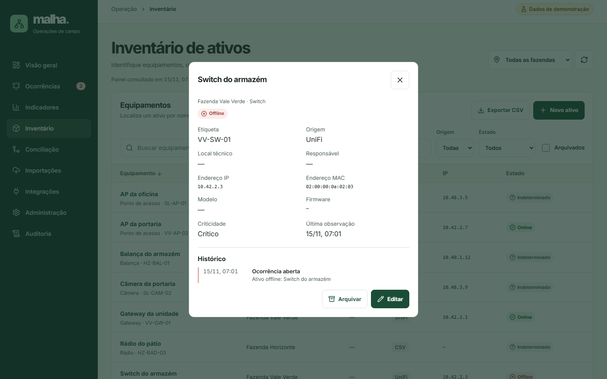 |

<details>
<summary><b>Princípios de interface</b></summary>

- Estados diferentes têm rótulos diferentes: “Seu navegador está sem conexão”, “Coletor sem contato” e “Coleta UniFi desatualizada” nunca se confundem. Sem dado fresco, o estado é **Indeterminado**, nunca “online”.
- Meta WCAG 2.2 AA: foco visível, controle completo por teclado, contraste 4,5:1, alvos de 44 px e diálogos nativos.
- Funciona a 360 px sem rolagem horizontal da página; no celular o inventário vira lista compacta e o menu rola em uma linha.
- Movimento só em aberturas e feedback de 120 a 200 ms, sempre respeitando `prefers-reduced-motion` (inclusive nas artes deste README).
- Horários gravados em UTC e exibidos no fuso IANA da fazenda.

<p align="center">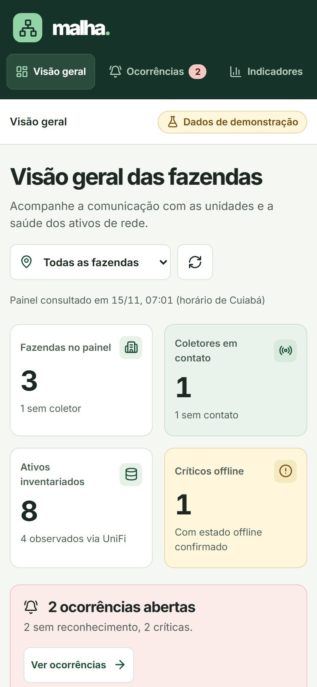</p>
</details>


Requisitos: Node.js **24.22.3** e pnpm **12.18.0**. O demo usa PGlite com dados fictícios e persiste em `.malha/demo` (use `MALHA_DEMO_DB=memory://` para uma sessão descartável).

```sh
npm install --global pnpm@12.18.0
pnpm install --frozen-lockfile
MALHA_MODE=demo pnpm dev
```

No PowerShell, use `$env:MALHA_MODE = 'demo'` antes de `pnpm dev`. Abra [http://127.0.0.1:3000](http://127.0.0.1:3000) para o painel e [/site](http://127.0.0.1:3000/site) para o site. Com Docker:

```sh
docker build --target web -t malha-web .
docker run --rm -p 3000:3000 -e MALHA_MODE=demo -e MALHA_DEMO_DB=memory:// malha-web
```

<details>
<summary><b>Roteiro do demo em 9 passos</b></summary>

1. Em **Importações**, selecione uma fazenda e envie o [CSV de exemplo](examples/inventario.csv). Valide, confira a prévia e confirme.
2. Em **Inventário**, filtre a fazenda, encontre `CAMPO-002` e abra os detalhes.
3. Em **Ocorrências**, veja o coletor sem contato da Fazenda Santa Luzia e o switch offline da Fazenda Vale Verde e reconheça uma delas.
4. Em **Administração**, cadastre uma fazenda e um membro. Em **Integrações**, gere o código de ativação da nova fazenda.
5. Em **Inventário**, use **Novo ativo** com local técnico, responsável e janela de manutenção. Arquive e restaure pelo detalhe, que mostra o histórico.
6. Em **Conciliação**, confira um item do cadastro e confirme ou vincule uma descoberta UniFi.
7. Em **Indicadores**, defina a linha de base. Em **Ocorrências**, registre um atendimento e volte aos indicadores.
8. Em **Auditoria**, veja as ações registradas e exporte o CSV.
9. No site, abra **Planos** e envie o **cadastro**. Liste as solicitações com `pnpm db requests`.

O CSV aceita UTF-8, até 5 MiB e 10 mil linhas, com as colunas `etiqueta`, `nome` e `categoria` e, opcionalmente, `criticidade`, `mac` e `ip`.
</details>

<details>
<summary><b>Coletor UniFi</b></summary>

Instale Go **1.27.4** e rode os comandos em `collector/`. Configure o prefixo local de Integrações documentado pela console, por exemplo `https://console.example/proxy/network/integration/v1`, uma chave da integração e a cadeia TLS confiável (`UNIFI_CA_FILE` para CA privada).

```sh
cd collector
go build -o malha-collector .
export UNIFI_BASE_URL='https://console.example/proxy/network/integration/v1'
export UNIFI_API_KEY_FILE='/caminho/protegido/unifi-api-key'
./malha-collector sites
export UNIFI_SITE_ID='<UUID do site selecionado>'
export MALHA_DATA_DIR='/caminho/gravavel/malha'
export MALHA_URL='https://malha.example'
export MALHA_ENROLL_CODE_FILE='/caminho/protegido/codigo-uso-unico'
./malha-collector enroll
unset MALHA_ENROLL_CODE_FILE
./malha-collector run
```

O código de ativação associa o coletor a uma única fazenda. Para testar com uma controladora de laboratório, inicie o demo com `MALHA_DEMO_DB=memory://`, use `MALHA_URL=http://127.0.0.1:3000` e `MALHA_ENROLL_CODE=malha-demo-entrada-000000000000000000000000` (fictício, vinculado à Fazenda Horizonte). Releases assinadas saem com a tag `collector-vX.Y.Z` e são instaladas com [`collector/deploy/update.sh`](collector/deploy/update.sh), que verifica assinatura e checksum e volta à versão anterior se o serviço não subir. Veja [o guia do serviço Linux](collector/README.md).
</details>

<details>
<summary><b>Ambiente de piloto</b></summary>

Use PostgreSQL 17 com endpoint privado (o [`compose.yml`](compose.yml) sobe um banco de laboratório). Configure `MALHA_MODE=pilot`, `DATABASE_URL` e as variáveis do [`.env.example`](.env.example). Cadastre a aplicação como **Web** no Entra ID, permita só o diretório do cliente, registre `https://<host-do-app>/api/auth/callback`, restrinja a atribuição de usuários e aplique MFA.

Prepare o banco com um papel administrativo separado. Após migrar, aplique [`packages/db/runtime-grants.sql`](packages/db/runtime-grants.sql) e conceda `malha_runtime` ao login do serviço, sem `SUPERUSER` nem `BYPASSRLS`.

```sh
pnpm db migrate
pnpm db configure <tenant-id> <oid-do-administrador> 'Grupo piloto'
pnpm db recipient <org-id> <email>
pnpm build
```

Depois do primeiro admin, fazendas, membros e coletores são cadastrados na interface. Rode `pnpm worker` junto com o serviço web e configure `MALHA_SMTP_URL` e `MALHA_ALERT_FROM` (o SMTP do Amazon SES serve). Na AWS, siga [`infra/README.md`](infra/README.md).
</details>

<details>
<summary><b>Estrutura e verificações</b></summary>

```text
apps/web/      Painel, API, ingestão, site e portal (Next.js)
apps/worker/   Outbox, regras de ocorrência, e-mail, retenção e métricas
packages/db/   Migrações SQL, grants do runtime e CLI de administração
collector/     Coletor Go, fila SQLite, serviço systemd e atualização assinada
infra/         Terraform da AWS em sa-east-1
tests/         Testes Node (PGlite) e Playwright
docs/          Arquitetura, jornada do site e artes deste README
```

```sh
pnpm lint && pnpm typecheck && pnpm test && pnpm build
pnpm exec playwright install chromium && pnpm test:e2e
cd collector && go test ./...
```

O CI roda tudo isso com PostgreSQL 17 real, constrói e sobe a imagem Docker e valida o Terraform. O workflow de segurança roda Semgrep, auditoria de dependências, Gitleaks e ClamAV.
</details>


<p align="center"></p>

O ponto de partida foi o documento de arquitetura técnica do MVP. Comparado com o código, ele mostrou que a parte difícil (coleta assinada, idempotência, RLS, Entra ID) estava pronta e que faltava o que faz o cliente usar o produto sozinho. Daí saíram quatro fases, cada uma entregue com testes unitários, testes no navegador e CI verde antes de entrar na `main`:

| Etapa | O que entrou |
| --- | --- |
| **MVP inicial** | Inventário por CSV, coletor UniFi assinado, painel, login Entra ID e site de apresentação ([#1](https://github.com/targino-tech/malha/pull/1)) |
| **Fase 1 · Ocorrências** | Regras a cada minuto, supressão durante perda de contato, reconhecimento auditado, e-mail de críticos agrupado por fazenda |
| **Fase 2 · Operação** | Administração e integrações na interface, papéis técnico e auditor com escopo por fazenda, cadastro e edição de ativos, inventário paginado no servidor |
| **Fase 3 · Valor medido** | Histórico de observações, conciliação, atendimentos e linha de base, indicadores da diretoria, auditoria e exportações seguras |
| **Fase 4 · Produção** | Docker, Terraform AWS, deploy com OIDC, release assinada do coletor, health check, logs estruturados e métricas EMF |
| **Site e portal** | Globo ASCII, planos, cadastro de interessados e portal de entrada ([#8](https://github.com/targino-tech/malha/pull/8)), correção da validação de e-mail da CLI ([#7](https://github.com/targino-tech/malha/pull/7)) |


<p align="center">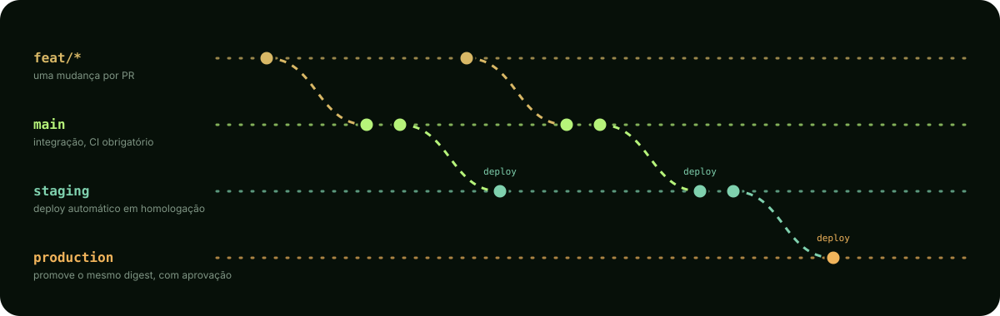</p>

| Branch | Papel | Como muda |
| --- | --- | --- |
| `main` | Código integrado e sempre verde | Só por PR com CI aprovado |
| `staging` | O que está em homologação | PR da `main`; o push constrói as imagens e implanta em `staging` |
| `production` | O que está em produção | PR da `staging` com aprovação; o push promove o mesmo digest já validado |
| `feat/*`, `fix/*` | Uma mudança por vez | Saem da `main` e voltam por PR |
| `dependabot/*` | Atualizações automáticas | Revisadas e mergeadas pela `main` |

O deploy automático fica desligado até a conta AWS existir: defina a variável de repositório `DEPLOY_ENABLED=true` e os GitHub Environments `staging` e `production` conforme [`infra/README.md`](infra/README.md).


| Próximo passo | Por que | Depende de |
| --- | --- | --- |
| Homologação em campo | Validar console física, firmware, Entra do cliente e 24 h sem WAN | Hardware e diretório do cliente |
| Prontidão de safra | Checklists versionados por fazenda com evidências e prazo | Responsável por fazenda |
| Conectores MikroTik e FortiGate | Mesmo contrato de observações para outras redes | Inventário de modelos e permissões |
| Starlink e link de failover | Saber se a fazenda caiu ou só trocou de link | Elegibilidade da conta Starlink |
| Servidor MCP somente leitura | Triagem assistida com o escopo de cada usuário | Qualidade de dados medida no piloto |
| Entrada e saída de pessoas | Admissão e desligamento ligados a SAP/TOTVS e Entra | Sistema de RH do cliente |
| Autocura com aprovação | Reiniciar porta PoE ou forçar failover com janela e retorno | Telemetria estável e ensaio em bancada |
| Cobrança online e provisionamento automático | Do cadastro do site ao grupo pronto sem a equipe | Modelo comercial validado |

## Segurança

Resultados de código, dependências, segredos e malware ficam no [workflow de segurança](https://github.com/targino-tech/malha/actions/workflows/security.yml). Consulte a [política de segurança](SECURITY.md) para relatar uma vulnerabilidade por um canal privado.
