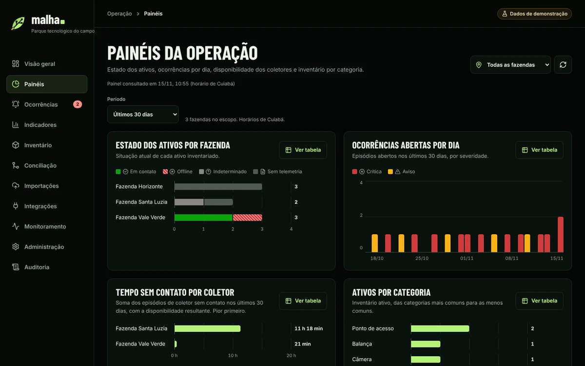
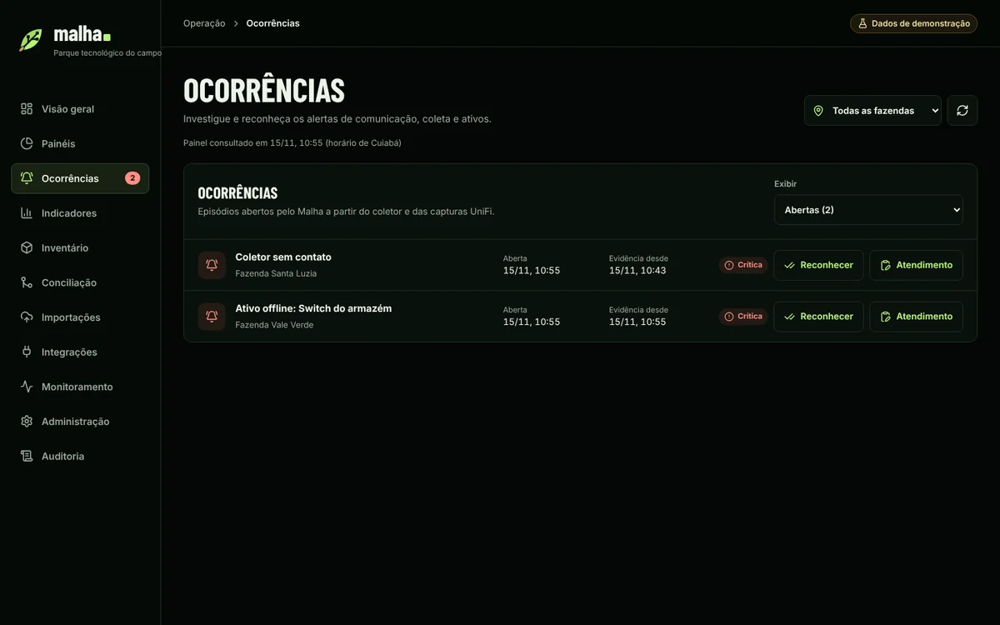
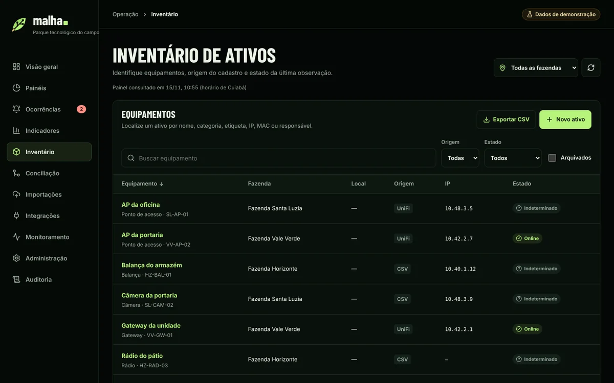
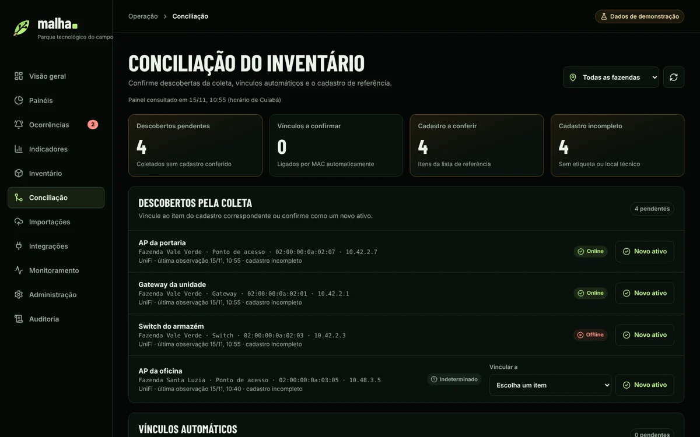
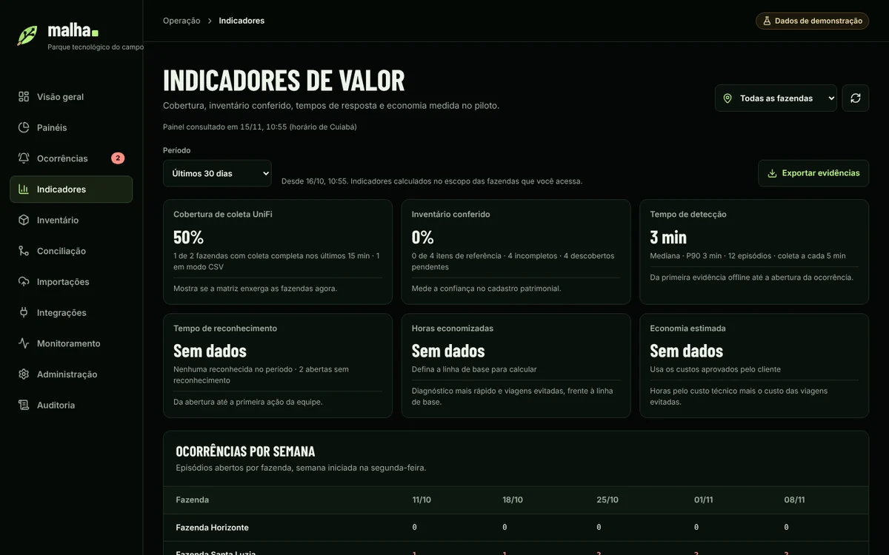
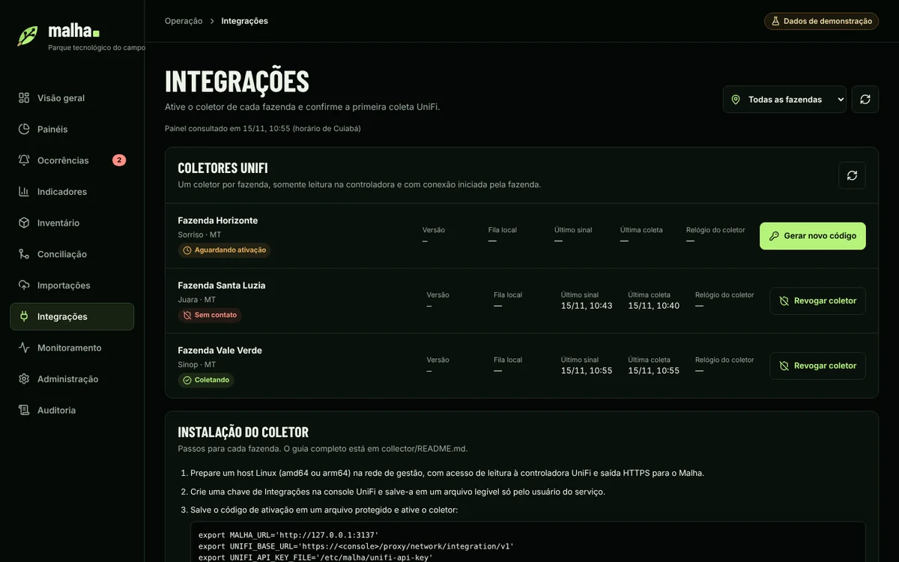
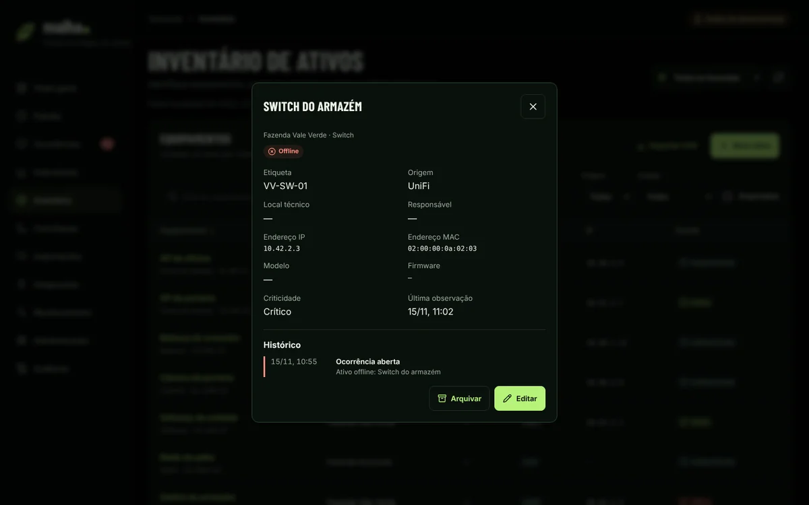
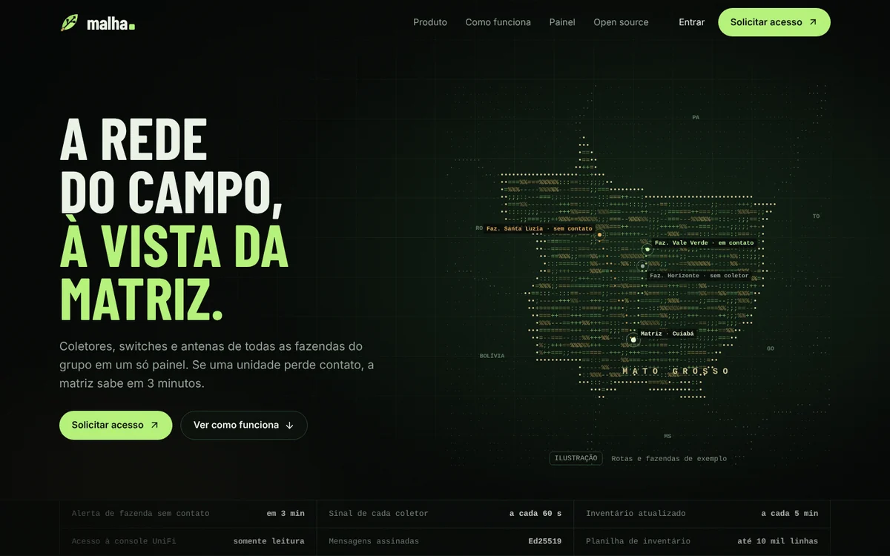
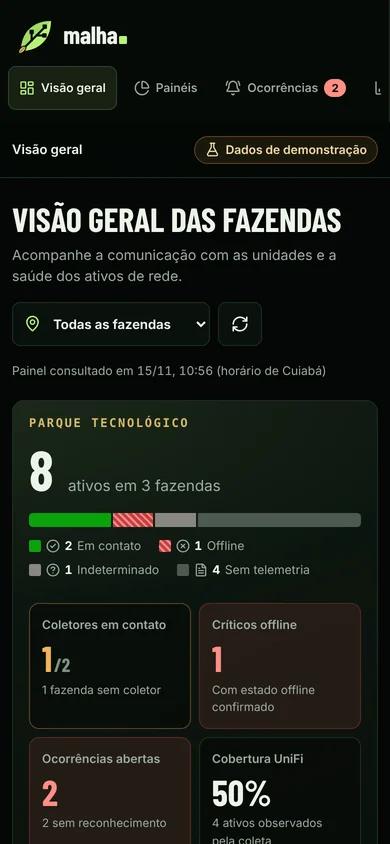

<p align="center">
  
</p>

<p align="center">
  <a href="https://targino-tech.github.io/malha/"><b>Site</b></a> ·
  <a href="#rode-o-demo"><b>Rodar o demo</b></a> ·
  <a href="docs/integracoes.md"><b>Integrações</b></a> ·
  <a href="CONTRIBUTING.md"><b>Contribuir</b></a> ·
  <a href="https://github.com/targino-tech/malha/discussions"><b>Comunidade</b></a> ·
  <a href="ROADMAP.md"><b>Roadmap</b></a>
</p>

<p align="center">
  <a href="https://github.com/targino-tech/malha/actions/workflows/ci.yml"></a>
  <a href="https://github.com/targino-tech/malha/actions/workflows/security.yml"></a>
  <a href="https://github.com/targino-tech/malha/actions/workflows/codeql.yml"></a>
  <a href="https://scorecard.dev/viewer/?uri=github.com/targino-tech/malha"></a>
  <a href="LICENSE"></a>
  <a href="CONTRIBUTING.md"></a>
</p>

<p align="center">
  
  
  
  
</p>


O Malha mostra à matriz de um grupo agrícola, em um só painel, **quais fazendas estão reportando, quais ativos críticos merecem investigação e onde o cadastro diverge da rede real**. Um coletor instalado em cada fazenda lê a controladora UniFi local (somente leitura) e envia lotes assinados para a nuvem. O cadastro patrimonial entra por CSV ou pela interface.

| Problema no campo | O que o Malha entrega |
| --- | --- |
| A TI só descobre a queda quando alguém liga da fazenda | Ocorrência aberta em até 3 min sem heartbeat, com e-mail para os críticos |
| A planilha de ativos não bate com o que está na rede | Conciliação entre cadastro e coleta, com fila de descobertas e divergências |
| Viagens para diagnosticar o que podia ser visto de longe | Histórico por ativo, atendimentos registrados e horas economizadas medidas |
| A diretoria não enxerga o valor da TI | Indicadores de cobertura, inventário conferido, tempo de detecção e economia |
| Medo de dar acesso à rede para um fornecedor | Coletor só faz GET, conexão sempre iniciada pela fazenda e mensagens assinadas |


<p align="center">
  
</p>

| Peça | Onde | Responsabilidade |
| --- | --- | --- |
| `collector/` | Linux na fazenda, Go 1.27, systemd | Lê a API local de Integrações do UniFi, assina com Ed25519, fila SQLite de 72 h |
| `apps/web/` | ECS Fargate ou Docker, Next.js 16 | Painel, API, ingestão `/v1/collectors`, login (Entra, AD/LDAP, OIDC), Zabbix e Grafana, site e portal |
| `apps/worker/` | ECS Fargate ou Docker | Outbox de capturas, regras a cada minuto, e-mail, retenção e métricas |
| `packages/db/` | PostgreSQL 17 (RDS ou próprio) | Migrações SQL, RLS por organização, CLI de administração |
| `infra/` | Terraform (opcional) | VPC, RDS, ECS, ALB + WAF, SES, ECR, alarmes, orçamento e OIDC do GitHub |
| `video/` | Node.js + Chromium + ffmpeg | Vídeo de apresentação de 45 s com trilha sintetizada |

**Garantias de segurança:** o escopo do coletor vem da chave cadastrada; cada requisição leva prova JWS com nonce de uso único e hash do corpo; lotes repetidos devolvem o recibo original e conteúdo divergente recebe 409; o runtime do banco opera sem `BYPASSRLS`; login por Entra ID (PKCE), AD/LDAP (LDAPS ou StartTLS) ou OpenID Connect por convite, com sessão revalidada a cada requisição; tokens de Zabbix, Grafana e a senha da conta LDAP ficam cifrados (AES-256-GCM); fazendas fora do escopo respondem como inexistentes. Detalhes em [`docs/arquitetura.md`](docs/arquitetura.md) e [`infra/README.md`](infra/README.md).


| Área | Funcionalidades |
| --- | --- |
| **Coleta** | Ativação com código de uso único, heartbeat 60 s, coleta 5 min, capturas em partes, idempotência, recuperação após queda da WAN, desvio de relógio do coletor |
| **Ocorrências** | Coletor sem contato, coleta desatualizada, ativo offline confirmado, divergência após 3 capturas; supressão durante perda de contato; reconhecimento auditado |
| **Alertas** | E-mail só para críticos, agrupado por fazenda, sem duplicatas, suspenso em manutenção |
| **Inventário** | CSV com prévia e erros por linha, cadastro manual, local técnico, responsável, janela de manutenção, arquivamento, busca e paginação no servidor |
| **Conciliação** | Descobertas UniFi, vínculos automáticos por MAC para confirmar ou desfazer, cadastro de referência para conferir, histórico transferido na fusão |
| **Painéis** | Estado dos ativos por fazenda, ocorrências por dia e severidade, tempo sem contato por coletor e ativos por categoria, com tabela alternativa, teclado e filtro de período |
| **Valor** | Atendimentos, linha de base aprovada pelo cliente, cobertura, inventário conferido, detecção (mediana e P90), reconhecimento, horas e economia, tendência semanal |
| **Acesso** | Login Entra ID, Active Directory/LDAP ou OpenID Connect (Google Workspace, Okta, Keycloak); admin, TI, técnico de fazenda, diretoria e auditor, com restrição por fazenda; administração de fazendas, membros e coletores pela interface |
| **Monitoramento** | Zabbix 7.0 e painéis Grafana montados do inventário por família de ativos, com Modelo Malha ou Modelo base; download dos arquivos ou aplicação direta pela API com token cifrado |
| **Parque** | Visão do parque tecnológico com mapa ASCII das fazendas, saúde por estado e famílias de ativos por fabricante |
| **Evidências** | Trilha de auditoria, exportação CSV de inventário, ocorrências e auditoria com fórmulas neutralizadas |
| **Site e portal** | Landing cinematográfica com globo ASCII, página open source, pedido de apoio na implantação com limite e honeypot, portal de entrada do cliente |
| **Produção** | Imagens Docker, Terraform AWS, deploy por OIDC com migração dedicada e smoke test, release assinada do coletor com retorno automático |


<p align="center"></p>


O símbolo é uma **folha cujas nervuras formam uma rede**: os nós quadrados são as fazendas e equipamentos, e o grão de trigo no talo lembra a safra. Site e painel usam o mesmo tema escuro, com fundo tinta, verde-limão e trigo da colheita. A tipografia combina **Barlow Condensed** nos títulos, **Inter** no texto e monoespaçada só em identificadores técnicos. Arquivos da marca em [`docs/media/marca`](docs/media/marca).

| Visão geral do parque | Painéis da operação |
| --- | --- |
|  |  |
| **Ocorrências** | **Monitoramento (Zabbix e Grafana)** |
|  |  |
| **Inventário** | **Conciliação** |
|  |  |
| **Indicadores** | **Integrações** |
|  |  |
| **Detalhe do ativo** | **Site público** |
|  |  |

<sub>Todas as telas usam os dados fictícios do modo demo.</sub>

<details>
<summary><b>Princípios de interface</b></summary>

- Estados diferentes têm rótulos diferentes: “Seu navegador está sem conexão”, “Coletor sem contato” e “Coleta UniFi desatualizada” nunca se confundem. Sem dado fresco, o estado é **Indeterminado**, nunca “online”.
- Cor nunca é a única pista: cada estado tem ícone, rótulo e, no offline, hachura; todo gráfico tem tabela alternativa.
- Meta WCAG 2.2 AA: foco visível, controle completo por teclado, contraste 4,5:1, alvos de 44 px e diálogos nativos.
- Funciona a 360 px sem rolagem horizontal da página; no celular o inventário vira lista compacta e o menu rola em uma linha.
- Movimento sempre respeitando `prefers-reduced-motion` (inclusive nas artes deste README).
- Horários gravados em UTC e exibidos no fuso IANA da fazenda.

<p align="center"></p>
</details>

<a id="rode-o-demo"></a>


Requisitos: Node.js **24.22.3** e pnpm **12.18.0**. O demo usa PGlite com dados fictícios e persiste em `.malha/demo` (use `MALHA_DEMO_DB=memory://` para uma sessão descartável).

```sh
npm install --global pnpm@12.18.0
pnpm install --frozen-lockfile
MALHA_MODE=demo pnpm dev
```

No PowerShell, use `$env:MALHA_MODE = 'demo'` antes de `pnpm dev`. Abra [http://127.0.0.1:3000](http://127.0.0.1:3000) para o painel e [/site](http://127.0.0.1:3000/site) para o site. Com Docker:

```sh
docker build --target web -t malha-web .
docker run --rm -p 3000:3000 -e MALHA_MODE=demo -e MALHA_DEMO_DB=memory:// malha-web
```

<details>
<summary><b>Roteiro do demo em 9 passos</b></summary>

1. Em **Importações**, selecione uma fazenda e envie o [CSV de exemplo](examples/inventario.csv). Valide, confira a prévia e confirme.
2. Em **Inventário**, filtre a fazenda, encontre `CAMPO-002` e abra os detalhes.
3. Em **Ocorrências**, veja o coletor sem contato da Fazenda Santa Luzia e o switch offline da Fazenda Vale Verde e reconheça uma delas.
4. Em **Administração**, cadastre uma fazenda e um membro. Em **Integrações**, gere o código de ativação da nova fazenda.
5. Em **Inventário**, use **Novo ativo** com local técnico, responsável e janela de manutenção. Arquive e restaure pelo detalhe, que mostra o histórico.
6. Em **Conciliação**, confira um item do cadastro e confirme ou vincule uma descoberta UniFi.
7. Em **Indicadores**, defina a linha de base. Em **Ocorrências**, registre um atendimento e volte aos indicadores.
8. Em **Auditoria**, veja as ações registradas e exporte o CSV.
9. No site, abra **Open source** e envie o **cadastro** de apoio. Liste as solicitações com `pnpm db requests`.

O CSV aceita UTF-8, até 5 MiB e 10 mil linhas, com as colunas `etiqueta`, `nome` e `categoria` e, opcionalmente, `criticidade`, `mac` e `ip`.
</details>

<details>
<summary><b>Coletor UniFi</b></summary>

Instale Go **1.27.4** e rode os comandos em `collector/`. Configure o prefixo local de Integrações documentado pela console, por exemplo `https://console.example/proxy/network/integration/v1`, uma chave da integração e a cadeia TLS confiável (`UNIFI_CA_FILE` para CA privada).

```sh
cd collector
go build -o malha-collector .
export UNIFI_BASE_URL='https://console.example/proxy/network/integration/v1'
export UNIFI_API_KEY_FILE='/caminho/protegido/unifi-api-key'
./malha-collector sites
export UNIFI_SITE_ID='<UUID do site selecionado>'
export MALHA_DATA_DIR='/caminho/gravavel/malha'
export MALHA_URL='https://malha.example'
export MALHA_ENROLL_CODE_FILE='/caminho/protegido/codigo-uso-unico'
./malha-collector enroll
unset MALHA_ENROLL_CODE_FILE
./malha-collector run
```

O código de ativação associa o coletor a uma única fazenda. Para testar com uma controladora de laboratório, inicie o demo com `MALHA_DEMO_DB=memory://`, use `MALHA_URL=http://127.0.0.1:3000` e `MALHA_ENROLL_CODE=malha-demo-entrada-000000000000000000000000` (fictício, vinculado à Fazenda Horizonte). Releases assinadas saem com a tag `collector-vX.Y.Z` e são instaladas com [`collector/deploy/update.sh`](collector/deploy/update.sh), que verifica assinatura e checksum e volta à versão anterior se o serviço não subir. Veja [o guia do serviço Linux](collector/README.md).
</details>

<details>
<summary><b>Ambiente de piloto</b></summary>

Use PostgreSQL 17 com endpoint privado (o [`compose.yml`](compose.yml) sobe um banco de laboratório). Configure `MALHA_MODE=pilot`, `DATABASE_URL` e as variáveis do [`.env.example`](.env.example). Cadastre a aplicação como **Web** no Entra ID, permita só o diretório do cliente, registre `https://<host-do-app>/api/auth/callback`, restrinja a atribuição de usuários e aplique MFA.

Prepare o banco com um papel administrativo separado. Após migrar, aplique [`packages/db/runtime-grants.sql`](packages/db/runtime-grants.sql) e conceda `malha_runtime` ao login do serviço, sem `SUPERUSER` nem `BYPASSRLS`.

```sh
pnpm db migrate
pnpm db configure <tenant-id> <oid-do-administrador> 'Grupo piloto'
pnpm db recipient <org-id> <email>
pnpm build
```

Depois do primeiro admin, fazendas, membros e coletores são cadastrados na interface. Rode `pnpm worker` junto com o serviço web e configure `MALHA_SMTP_URL` e `MALHA_ALERT_FROM` (o SMTP do Amazon SES serve). Na AWS, siga [`infra/README.md`](infra/README.md).
</details>

<details>
<summary><b>Estrutura e verificações</b></summary>

```text
apps/web/      Painel, API, ingestão, site e portal (Next.js)
apps/worker/   Outbox, regras de ocorrência, e-mail, retenção e métricas
packages/db/   Migrações SQL, grants do runtime e CLI de administração
collector/     Coletor Go, fila SQLite, serviço systemd e atualização assinada
infra/         Terraform da AWS em sa-east-1
tests/         Testes Node (PGlite) e Playwright
docs/          Arquitetura, jornada do site e artes deste README
```

```sh
pnpm lint && pnpm typecheck && pnpm test && pnpm build
pnpm exec playwright install chromium && pnpm test:e2e
cd collector && go test ./...
```

O CI roda tudo isso com PostgreSQL 17 real, constrói e sobe a imagem Docker e valida o Terraform. O workflow de segurança roda Semgrep, auditoria de dependências, Gitleaks e ClamAV.
</details>


### Branches e entrega

| Branch | Papel | Como muda |
| --- | --- | --- |
| `main` | Código integrado e sempre verde; publica o site no GitHub Pages | PR com CI e revisão aprovados |
| `staging` | O que está em homologação | PR da `main`; o push constrói as imagens e implanta em homologação |
| `production` | O que está em produção | PR da `staging` com aprovação; o push promove a mesma imagem já validada |
| `feat/*`, `fix/*`, `docs/*` | Uma mudança por vez, no fork de quem contribui | Saem da `main` e voltam por PR |

O deploy na AWS fica desligado até a conta existir: defina a variável de repositório `DEPLOY_ENABLED=true` e os GitHub Environments `staging` e `production` conforme [`infra/README.md`](infra/README.md). Até lá, um push em `staging` ou `production` não implanta nada.


| Integração | O que faz | Como |
| --- | --- | --- |
| **UniFi Network** | Coletor Go na fazenda lê a API local só com GET e envia lotes assinados | [Coletor](docs/integracoes.md#coletor-unifi) |
| **Planilha CSV** | Importa o cadastro patrimonial com prévia e erro por linha | [CSV](docs/integracoes.md#planilha-csv) |
| **Zabbix 7.0** | Hosts por ativo, agrupados por fazenda e família, com templates SNMP/agente | [Zabbix e Grafana](docs/integracoes.md#zabbix-e-grafana) |
| **Grafana** | Um painel por família (tráfego, erros, CPU, memória, latência) | [Zabbix e Grafana](docs/integracoes.md#zabbix-e-grafana) |
| **Microsoft Entra ID** | Login com MFA e escopo do diretório do cliente | [Piloto](#rode-o-demo) |
| **Active Directory / LDAP** | Login com a conta da rede, por LDAPS ou StartTLS | [LDAP](#login-por-active-directory-ou-ldap) |
| **Google Workspace, Okta, Keycloak** | Login OpenID Connect por convite de e-mail | [OIDC](#login-por-google-workspace-okta-keycloak-ou-outro-openid-connect) |
| **SMTP / Amazon SES** | E-mail de alertas críticos agrupado por fazenda | [Alertas](docs/integracoes.md#e-mail-de-alertas) |

### Modelos de monitoramento

O Malha classifica cada ativo numa família (núcleo, Wi-Fi, rádio, domínio, servidores, estações, campo, segurança física) e num fabricante (Cisco, Huawei, Ubiquiti, MikroTik, Fortinet, Aruba, Intelbras, TP-Link, Windows, Linux). Daí sai o monitoramento:

- **Modelo Malha**: templates oficiais do Zabbix 7.0 por família e fabricante (por exemplo, `Cisco IOS by SNMP`, `Ubiquiti AirOS by SNMP`, `Windows by Zabbix agent`) e painéis com tráfego, erros, CPU e memória.
- **Modelo base**: só disponibilidade, latência e perda por ICMP. Funciona em qualquer Zabbix, sem SNMP nem agente.

Entrega por arquivo (JSON do Zabbix e painéis do Grafana para importar) ou direto pela API, com o token cifrado. Detalhes e a tabela completa no [guia de integrações](docs/integracoes.md#zabbix-e-grafana).


O Malha é feito em comunidade, por gente de TI, do agro e do software livre. Qualquer ajuda conta:

| Quero… | Caminho |
| --- | --- |
| Tirar uma dúvida | [Discussões → Perguntas e respostas](https://github.com/targino-tech/malha/discussions/categories/q-a) |
| Sugerir uma ideia | [Discussões → Ideias](https://github.com/targino-tech/malha/discussions/categories/ideas) |
| Mostrar como uso o Malha | [Discussões → Mostre e conte](https://github.com/targino-tech/malha/discussions/categories/show-and-tell) |
| Relatar um erro | [Issue de erro](https://github.com/targino-tech/malha/issues/new?template=erro.yml) |
| Pedir um fabricante, template ou provedor novo | [Issue de integração](https://github.com/targino-tech/malha/issues/new?template=integracao.yml) |
| Contribuir com código ou documentação | [Como contribuir](CONTRIBUTING.md) e as [boas primeiras issues](https://github.com/targino-tech/malha/labels/boa%20primeira%20issue) |
| Pedir apoio na implantação | [Issue de implantação](https://github.com/targino-tech/malha/issues/new?template=implantacao.yml) |

Todo pull request passa pelo CI (web, banco, navegador, coletor, Docker e Terraform), pela análise de segurança (CodeQL, Semgrep, Gitleaks, ClamAV, dependências) e pela revisão de um mantenedor. Os critérios completos estão no [CONTRIBUTING](CONTRIBUTING.md#critérios-para-aceitar-um-pull-request); os papéis e como as decisões são tomadas, na [governança](GOVERNANCE.md). Todos seguem o [código de conduta](CODE_OF_CONDUCT.md).

<a href="https://github.com/targino-tech/malha/graphs/contributors"></a>


Em andamento: exportação de planilhas padronizada com marca d'água, validação dos templates do Zabbix em servidor real e testes do login OIDC com provedores reais. Depois: conectores MikroTik e FortiGate, Starlink e failover, prontidão de safra e tradução. A lista completa, com o porquê de cada item, está no [ROADMAP](ROADMAP.md).

## Segurança

Vulnerabilidades vão pelo **[relato privado do GitHub](https://github.com/targino-tech/malha/security/advisories/new)**, nunca por issue pública. Veja a [política de segurança](SECURITY.md) para o escopo e como tratamos cada relato.

A cada mudança rodam [CodeQL](https://github.com/targino-tech/malha/actions/workflows/codeql.yml), [Semgrep, Gitleaks, ClamAV e auditoria de dependências](https://github.com/targino-tech/malha/actions/workflows/security.yml), revisão de dependências nos pull requests e o [OpenSSF Scorecard](https://scorecard.dev/viewer/?uri=github.com/targino-tech/malha). Os resultados ficam em **Security → Code scanning**.

> **Nunca exponha o modo demo na internet.** Ele entra como administrador sem login e usa chaves fixas, feitas só para teste local. Em qualquer instalação acessível por outras pessoas, use `MALHA_MODE=pilot` com `MALHA_AUTH_SECRET` própria.

## Login por Active Directory ou LDAP

Além do Microsoft Entra ID, o portal aceita a conta da rede. Configure o diretório do grupo pela CLI, com a senha da conta de serviço em arquivo protegido:

```sh
export MALHA_AUTH_SECRET='<a mesma do serviço web>'
export MALHA_LDAP_BIND_PASSWORD_FILE='/caminho/protegido/senha-servico'
pnpm db ldap <org-id> grupo.local ldaps://dc.grupo.local:636 'DC=grupo,DC=local' 'CN=svc-malha,OU=Servicos,DC=grupo,DC=local'
```

Só conexões cifradas são aceitas (`ldaps://`, ou `ldap://` com StartTLS automático). Para OpenLDAP, use `MALHA_LDAP_ID_ATTRIBUTE=entryUUID`; para uma CA própria, `MALHA_LDAP_CA_FILE`. Cada pessoa entra como membro em Administração pelo `objectGUID` (ou `entryUUID`). A senha da conta de serviço fica cifrada no banco, as tentativas são limitadas e o login vai para a auditoria.

## Login por Google Workspace, Okta, Keycloak ou outro OpenID Connect

Um provedor OIDC genérico pode atender um grupo, ao lado do Entra ID e do LDAP. No provedor, cadastre um aplicativo web com o redirecionamento `https://<seu-dominio>/api/auth/oidc/callback` e configure o serviço:

```sh
export MALHA_PUBLIC_ORIGIN='https://malha.grupo.com.br'
export MALHA_OIDC_ISSUER='https://accounts.google.com'   # ou https://<tenant>.okta.com, https://<keycloak>/realms/<realm>
export MALHA_OIDC_CLIENT_ID='...'
export MALHA_OIDC_CLIENT_SECRET='...'
export MALHA_OIDC_ORG_ID='<uuid do grupo>'
export MALHA_OIDC_NAME='Google'                           # rótulo do botão "Entrar com ..."
```

O acesso continua por convite: em Administração, crie o membro com o **e-mail do convite** (o identificador no diretório pode ficar em branco). No primeiro login, o Malha só aceita a conta se o provedor confirmar o e-mail como verificado; a partir daí a conta fica ligada pelo identificador estável do provedor (`iss` + `sub`), mesmo que o e-mail mude depois. O convite só pode ser usado uma vez, a ligação vai para a auditoria e desativar o membro bloqueia o login.


## Site público no GitHub Pages

A versão estática do site (sem painel e sem servidor) é publicada pelo workflow [`pages.yml`](.github/workflows/pages.yml) a cada mudança no site na `main`. Com o repositório público, ative em **Settings → Pages → Source: GitHub Actions**; o endereço fica `https://<dono>.github.io/malha/`. Para gerar localmente: `node scripts/build-static-site.mjs` (saída em `apps/site-static/out`). Nessa versão, "Entrar" e o cadastro apontam para o repositório: rodar o demo e pedir apoio por issue.


## Licença

O Malha é software livre e gratuito, distribuído sob a [GNU Affero General Public License v3.0 ou posterior](LICENSE). Você pode usar, estudar, modificar e redistribuir o código. Se oferecer uma versão modificada como serviço pela rede, a AGPL exige disponibilizar o código-fonte dessa versão aos usuários dela.
